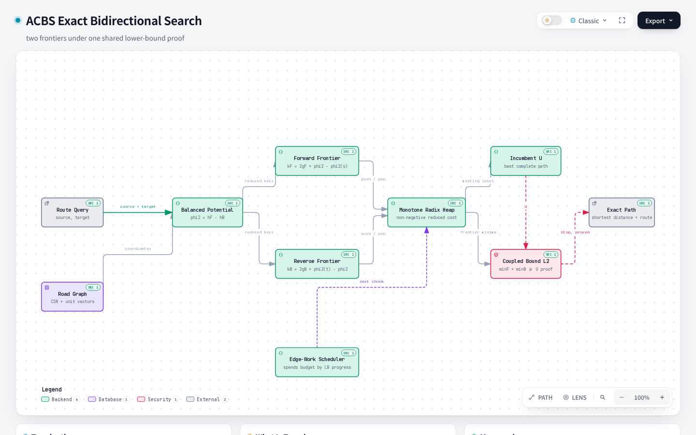

# ACBS: an exact bidirectional search with an adaptive edge-work scheduler

Author: sahen

Status: draft for internal review. Not submitted. No external review has taken
place.

## Abstract

We describe Aegis Coupled-Bound Search (ACBS), an exact point-to-point
shortest-path algorithm for weighted directed road graphs. ACBS advances a
forward and a reverse frontier under a single admissible potential and stops when
the sum of the two frontier minimum priority keys reaches the best complete path
found. That stopping rule is a standard reduced-cost bidirectional rule, not a
contribution, and Section 4 explains why it is also not the g-bound that an
earlier draft claimed. What ACBS adds is a scheduler that decides which frontier
receives the next chunk of edge work, using the observed rise in the coupled
lower bound per unit of work.

We measured ACBS against Dijkstra, bidirectional Dijkstra, and A* on real
OpenStreetMap networks for Tokyo (1,098,173 nodes) and Osaka (748,903 nodes),
under both a distance metric and a travel-time metric. Every query returned an
exact shortest path. Against bidirectional Dijkstra, the median speedup was 6.04
times in Tokyo and 4.38 times in Osaka on distance, and 1.82 and 1.54 times on
travel time. Against plain unidirectional Dijkstra the ratios are larger, 8.64 and
6.59 on distance; the tables report both baselines so the two are not confused.
The advantage shrinks as the geographic lower bound carries less information, and
on a synthetic uniform lattice it disappears entirely. We report that reversal
rather than omitting it.



## 1. Scope and what is new

This note reports measurements rather than a new algorithm. Two concepts must be
distinguished.

**Not new: the termination rule.** ACBS terminates when the sum of the two
frontier minimum priority keys reaches the incumbent, both in reduced units.
Section 4 shows that this is a standard reduced-cost bidirectional rule and that
it is *not* the g-bound, contrary to what an earlier draft of this note asserted.
Siag et al. (2023) enumerate seventeen non-dominated global bounds and prove that
the maximum over available bounds is the tightest single condition. ACBS does not
evaluate any of them directly, because its heaps are ordered by reduced key. An
earlier internal note described the rule as a contribution. It is not.

**The candidate contribution: the scheduler.** Given a fixed potential and a
fixed stopping rule, an exact bidirectional search still has freedom in how much
edge work to give each frontier before reconsidering. ACBS measures, online, how
much the coupled lower bound rose per unit of work in each direction, and
allocates the next chunk accordingly. The ablation that removes only the
scheduler, keeping the potential and the stopping rule identical, is available
as `aegis-static`.

Whether that scheduler is genuinely distinct from prior expansion policies is
**not yet established**. Siag et al. describe expansion policies aimed at
raising a chosen bound quickly; a scheduler that raises the coupled bound
quickly is plausibly an instance of that idea rather than a departure from it.
`docs/NOVELTY_CHECKLIST.md` records this as an open item.

## 2. The search

For source s, target t, and node v, the following hold.

- `g_F(v)` is the best known cost from s to v, `g_B(v)` the best known cost
  from v to t.
- `h_F(v)` is an admissible lower bound on the cost from v to t, and `h_B(v)`
  the corresponding bound from s to v. Both are derived from Earth-chord
  distance scaled by a conservative minimum cost per metre, so both are zero
  when coordinates or a safe scale are unavailable.
- The balanced potential is `phi2(v) = h_F(v) - h_B(v)`.
- Priority keys for node v are `k_F(v) = 2 g_F(v) + phi2(v) - phi2(s)` and
  `k_B(v) = 2 g_B(v) + phi2(t) - phi2(v)`.
- `U` is the cost of the best complete path found so far.

Consistency of the directional bounds keeps reduced edge costs non-negative in
both directions, which lets each frontier use label setting on its reduced-cost
graph.

## 3. The scheduler

This is the only component this note offers as a contribution, so it is
specified here in enough detail to reimplement. Section 4 then shows that the
stopping rule, by contrast, is standard.

The search proceeds in **chunks**. At the start of each chunk it chooses a
direction and a budget, expands up to that budget, then updates its estimate of
how productive each direction has been.

### 3.1 State

Two quantities are kept per direction, both integer scalars rather than arrays.

- `score_D`, an exponentially weighted estimate of how much the coupled lower
  bound rose per unit of work in direction D, scaled by 10^6.
- `sampled_D`, false until direction D has completed at least one chunk.

Plus `last`, the direction of the previous chunk, and `consecutive`, the number
of chunks taken in that same direction.

### 3.2 Work and gain

After a chunk ends, let `dLB` be the increase in the coupled lower bound
`min_F k_F + min_B k_B` across the chunk, and let

```
work = relaxedEdges + 4 * expandedNodes + 2 * queueGrowth
```

where `queueGrowth` is the change in the sum of the two queue lengths, counted
only when positive. Expanding a node is charged four times one relaxation, and
growing the frontier is charged twice, so the measure reflects allocation and
memory traffic rather than only relaxation count. The instantaneous score is

```
instant = 10^6 * dLB / work        (work is never 0)
```

The running estimate is an exponential moving average with weight 1/4.

```
score_D = score_D - score_D/4 + instant/4
```

### 3.3 Choosing the direction

The rules apply in priority order.

1. If `sampled_F` is false, choose F. If `sampled_B` is false, choose B. The
   two directions are warmed up before their scores are compared.
2. If `consecutive >= 6`, choose the opposite of `last`. Alternating
   periodically stops the estimate of the idle direction from going stale.
3. If `score_F > 1.1 * score_B`, choose F. If `score_B > 1.1 * score_F`,
   choose B. The 10 percent margin is a dead band, so a small difference in the
   estimates does not flip the direction every chunk.
4. Otherwise the estimates are close. Break the tie by the smaller frontier
   minimum key, then by the smaller degree (out-degree forward, in-degree
   reverse), then by the shorter queue, then F.

The last two rules are the same as the static ablation, so the adaptive
scheduler only overrides them when the efficiency estimates differ by more than
the dead band.

### 3.4 Choosing the budget

```
base = 256 edges    if the graph has  < 10,000 edges
     = 1024 edges   if it has between 10,000 and 100,000
     = 2048 edges   otherwise

budget = base
if score_other > 0 and score_chosen >= 2 * score_other: budget = 2 * base
if score_other > 0 and score_chosen >= 4 * score_other: budget = 4 * base
if an upper bound has been found and budget > 2 * base: budget = 2 * base
```

The budget is edge work, not node count. A direction measured at twice the other
gets twice the work, and one measured at four times gets four times as much,
before the scheduler reconsiders. Once a complete path is known, the multiplier is capped
at two, because the remaining job is to raise the lower bound far enough to
prove that path optimal, and alternating helps with that more than concentrating
work does.

### 3.5 The static ablation

`aegis-static` is identical except that it always uses `base` as the budget and
skips rules 3.3.1 to 3.3.3, choosing directly by the tie-break order in 3.3.4.
That is the comparison used in Section 1 and Section 6.5.

## 4. What the termination rule is, and what it is not

The implementation stops when the sum of the two frontier minimum keys reaches
the incumbent, both expressed in reduced units:

```
min_{u in Open_F} k_F(u) + min_{w in Open_B} k_B(w) >= 2U + phi2(t) - phi2(s)
```

(`internal/search/acbs.go`). Substituting `phi2(v) = h_F(v) - h_B(v)` and writing
u and w for the two frontier minima gives

```
k_F(u) + k_B(w) = 2(g_F(u) + g_B(w)) + h_F(t) - h_B(s) + (h_F(u) - h_B(u)) - (h_F(w) - h_B(w))
```

so the cancellation is exact only when u and w carry the same potential, which holds once the
frontiers have met. Away from the meeting point the extra `(phi2(u) - phi2(w))` term
remains.

**This is not the g-bound, and an earlier draft of this section wrongly said it was.**
The g-bound of Siag et al. (bound B3) is

```
min_{x in Open_F} g_F(x) + min_{y in Open_B} g_B(y) + epsilon
```

which takes the minimum of the *original* g-values across each whole frontier and
uses no potential at all. ACBS does not track those minima. Its heaps are ordered
by reduced key, so the node carrying the smallest key is not in general the node
carrying the smallest g. The reduced-key sum is therefore a lower bound of a
different kind, valid because the reduced costs are non-negative, but it is not
bound B3.

This distinction matters twice over. It removes the claim that ACBS reuses a
known bound, which is a claim we cannot support; and it explains the failure
recorded in Section 6.5, where deriving the f-bound and the b-bound from
frontier nodes and converting them into reduced units produced values above the
true optimum.

Two consequences follow, and both shape what this note can claim.

First, the stopping rule used here is a standard reduced-cost bidirectional rule,
not a contribution. Whatever advantage the measurements show therefore comes from
the order in which work is performed, not from the test that ends the search.

Second, Siag et al. observe that taking the maximum over several available
bounds gives the tightest condition available. ACBS consults only one. Section
6.5 reports what happened when we tested the obvious follow-up.

## 5. Method

All comparisons use the same graph object, the same query set, the same warmup,
and an interleaved measurement order, with no preprocessing for any algorithm.
Steady-state allocation is zero bytes per query for every algorithm. Results are
reported as the median over repeated measurements and as a paired comparison of
the same queries, because the two disagree on some graphs.

**Data.** OpenStreetMap extracts from Geofabrik, restricted to a box around the
city centre and to ways that carry vehicle traffic, imported with the `car`
profile. The edge cost is `ceil(meters * 1000)` for the distance metric and
`ceil(meters / speed * 1000)` for the travel-time metric.

| Graph | Nodes | Directed edges | heuristicStrength (distance / time) |
|---|---:|---:|---:|
| Tokyo | 1,098,173 | 2,262,568 | 0.9999 / 0.2505 |
| Osaka | 748,903 | 1,575,615 | 1.0000 / 0.2786 |
| Synthetic lattice | 1,000,000 | 2,596,627 | 0.9955 |

`heuristicStrength` is the ratio of the minimum to the mean cost per metre. In
mathematics a bound is *saturated* when equality holds, which is the opposite of
what happens here, so the term is avoided. A travel-time metric makes the
geographic bound much **looser**: to stay admissible it must assume the slowest
possible speed everywhere, while real roads vary widely. That loses pruning
power, which is why travel time is reported separately.

## 6. Results

### 6.1 Distance metric

| Graph | Algorithm | Median | p95 | vs Dijkstra | Expanded | Correct |
|---|---|---:|---:|---:|---:|---:|
| Tokyo | Dijkstra | 72.35 ms | 156.88 ms | 1.00x | 531,031 | 400/400 |
| Tokyo | bidirectional Dijkstra | 50.60 ms | 125.64 ms | 1.43x | 368,789 | 400/400 |
| Tokyo | A* | 16.95 ms | 104.08 ms | 4.27x | 70,630 | 400/400 |
| Tokyo | ACBS | **8.38 ms** | **46.77 ms** | **8.64x** | 44,201 | 400/400 |
| Osaka | Dijkstra | 50.65 ms | 119.15 ms | 1.00x | 373,981 | 300/300 |
| Osaka | bidirectional Dijkstra | 33.71 ms | 87.97 ms | 1.50x | 234,918 | 300/300 |
| Osaka | A* | 13.70 ms | 87.83 ms | 3.70x | 57,780 | 300/300 |
| Osaka | ACBS | **7.69 ms** | **48.52 ms** | **6.59x** | 34,137 | 300/300 |

Paired against bidirectional Dijkstra, ACBS finished ahead on 390 of 400 Tokyo
queries and 288 of 300 Osaka queries.

### 6.2 Travel-time metric

| Graph | Algorithm | Median | p95 | vs Dijkstra | Expanded | Correct |
|---|---|---:|---:|---:|---:|---:|
| Tokyo | Dijkstra | 95.54 ms | 198.28 ms | 1.00x | 554,840 | 300/300 |
| Tokyo | bidirectional Dijkstra | 50.23 ms | 127.40 ms | 1.90x | 319,568 | 300/300 |
| Tokyo | A* | 62.94 ms | 263.30 ms | 1.52x | 229,332 | 300/300 |
| Tokyo | ACBS | **27.64 ms** | **94.97 ms** | **3.46x** | 120,199 | 300/300 |
| Osaka | Dijkstra | 56.53 ms | 120.43 ms | 1.00x | 362,323 | 300/300 |
| Osaka | bidirectional Dijkstra | 25.68 ms | 80.22 ms | 2.20x | 183,213 | 300/300 |
| Osaka | A* | 41.51 ms | 171.00 ms | 1.36x | 166,990 | 300/300 |
| Osaka | ACBS | **16.70 ms** | **85.95 ms** | **3.39x** | 84,249 | 300/300 |

Paired against bidirectional Dijkstra, ACBS finished ahead on 252 of 300 Tokyo
queries and 223 of 300 Osaka queries.

A weak lower bound is only useful if it remains a valid one, so admissibility
was checked directly on the travel-time graph. Across 80 sampled source-target
pairs, the geographic bound never exceeded the exact shortest-path distance.

### 6.3 Where the advantage comes from

A speedup can come from expanding fewer nodes, or from doing cheaper work per
node. The two matter differently to anyone trying to reproduce or extend the
result, so they are separated here.

The measurements below are on the Tokyo distance graph, against bidirectional
Dijkstra, over the same 300 queries.

| Algorithm | Median time | Median expanded | Time per expanded node |
|---|---:|---:|---:|
| bidirectional Dijkstra | 61.45 ms | 411,246 | 149.4 ns |
| ACBS | 9.76 ms | 44,726 | 218.2 ns |

The total speedup is 6.30x, and it factors into two terms.

```
6.30x = 9.19x (fewer expansions) * 0.68x (higher per-node cost)
```

**ACBS buys its speed by expanding nine times fewer nodes, and it pays for that
with 46 percent more work per node.** Bidirectional Dijkstra expands nine times
as many nodes, but each one is cheaper to process.

Per-node cost is the median duration divided by the median expanded count, so it
mixes the cost of a pop, the cost of the edges scanned out of that node, and the
fixed setup of a query. ACBS does more per node than a plain Dijkstra loop: it
evaluates the potential at each relaxed neighbour, maintains an efficiency score
per direction, and decides direction and budget at chunk boundaries. None of
that appears in a bidirectional Dijkstra inner loop. The numbers say that
overhead is real and measurable, and that it is still worth paying.

This decomposition also explains why ACBS does poorly on a uniform lattice. On a
lattice the expansion advantage largely evaporates, so the per-node penalty stays
while the benefit it was paying for does not.

The distinction is not new to the field. Wang et al. (2025), following Siag et al.
(2023), recommend BAE* as the default for the consistent-heuristic case on the
grounds that it strikes "a good balance between node expansions and runtime
across different domains and heuristics". Treating the two as separate quantities
is therefore the convention, and this section reports them separately for that
reason.

#### By query class

The advantage is not uniform across query lengths. It is weakest on the shortest
queries.

| Query class | n | ACBS median | bidirectional Dijkstra | Speedup | ACBS faster on |
|---|---:|---:|---:|---:|---:|
| local | 100 | 0.19 ms | 0.51 ms | 2.69x | 93% |
| random | 100 | 9.76 ms | 61.45 ms | 6.30x | 100% |
| regional | 100 | 34.66 ms | 116.63 ms | 3.36x | 100% |

Local queries gain least because at that scale the fixed cost of setting up the
search is a large share of the total, and there is little room for a better
expansion order to show. Regional queries gain less than random ones even though
they are longer: both frontiers sweep a wider area, and the asymmetry the
scheduler exploits is less pronounced.

The 93 percent figure on local queries is the honest headline for that class.
Seven queries out of a hundred do not beat bidirectional Dijkstra at all.

A reader comparing this section with Table 6.1 will notice 6.30x here and 6.04x
there, for what looks like the same comparison. They are different runs: Table
6.1 is a 400-query run on this graph, this section is a 300-query rerun, and the
query samples differ between them even at the same seed. Two honest medians of
the same algorithm on the same graph can differ by several percent because of
which queries were drawn, which is exactly why Section 6.3 reports paired
win counts alongside medians.

A note on the median. The benchmark defines the median as the nearest-rank 50th
percentile (the lower of the two middle values over 300 queries). An
interpolated median gives slightly different values, for example 9.77 ms rather
than 9.76 ms for ACBS. An earlier draft of this section mixed the two conventions
and also dropped duplicate query pairs, which produced 6.31x and a per-node
penalty of 43 percent; both figures were wrong in proportion, not in direction.
The values above are reported in the benchmark's own convention throughout.

### 6.4 Where the advantage goes away

The gain depends on the metric. To isolate that dependence, a 1,000,000-node
uniform lattice was re-weighted so that the same topology carries progressively
less geographic information.

| heuristicStrength | ACBS vs bidirectional Dijkstra, paired |
|---:|---:|
| 0.996 | 1.001 (tied) |
| 0.434 | 0.926 |
| 0.311 | 0.991 |
| 0.264 | 1.002 |
| 0.202 | 1.099 |
| 0.096 | 1.203 |

On the lattice the advantage is absent even at high heuristic strength and
becomes a clear loss as the bound weakens. A uniform lattice rewards both
frontiers about equally, so there is little asymmetry for a scheduler to exploit.
Real road networks are irregular, and there the same scheduler keeps an
advantage even when the bound is weak.

This reversal is not unique to ACBS. Holte et al. (2017) note that as heuristic
accuracy changes, the advantage shifts between algorithms, and Shperberg et al.
(2020) formalise the related property of well-behavedness. Wang et al. (2025)
report the same direction in their own experiments, with their MEET algorithm
roughly on par with A* on one grid map and about twice as slow on another where
the heuristics are less informative.

### 6.5 Do more bounds help?

Sections 5.1 through 5.3 measure the speed of ACBS but say nothing about whether
its stopping condition can be tightened. This section reports an attempt to do
that, and why it did not produce the answer we wanted.

The intent was to terminate on the maximum of several admissible global bounds,
following Siag et al. (2023), who show that the maximum over the bounds an
algorithm can keep is the tightest condition available. Two variants were built.

- `multibound`, a plain bidirectional A* with no scheduler, so that only the
  stopping condition varies;
- a bound-mode switch on ACBS itself, so that the scheduler could be held fixed
  while only the stopping condition widened.

**Both variants were unsound and neither is in the released code.** The
diagnosis is worth recording because it is the same mistake twice.

The frontiers are ordered by reduced key. That key is a function of the node's
`g`, its potential, and the source or target potential, so the node carrying the
smallest reduced key is *not* in general the node carrying the smallest `g`.
Deriving an f-bound or a b-bound from the peeked node, and then converting that
value into reduced units to compare against the reduced incumbent, mixes two
different orderings. The result exceeded the true optimum, which is exactly what
a lower bound must never do: on real Tokyo queries the ACBS variant returned
overestimates on 5 of 40 sampled pairs, and the unscheduled variant on 33 of 300.
A "lower bound" that reaches 37,707,590 against a true optimum of 36,691,793 is
not a lower bound.

The bound-mode switch was reverted rather than shipped behind a flag, because a
termination condition that is wrong in the unsafe direction runs fast and answers
wrongly. What remains in the release is the plain `multibound` variant, and even
that one must be read carefully: after the fix it computes the reduced-key sum
and then assigns the same value to the f-bound and the b-bound slots, so it is
in practice only the reduced-cost rule plus a smaller-key expansion order. It is
kept as a measurement vehicle, not as an implementation of the multi-bound idea.

Measured on the Tokyo graph with the distance metric, 300 queries, all correct.

| Algorithm | Median | vs Dijkstra | Expanded | Relaxed | Correct |
|---|---:|---:|---:|---:|---:|
| Dijkstra | 81.06 ms | 1.00x | 531,266 | 1,091,302 | 300/300 |
| bidirectional Dijkstra | 61.45 ms | 1.32x | 411,246 | 818,508 | 300/300 |
| A* | 18.33 ms | 4.42x | 70,630 | 144,344 | 300/300 |
| ACBS | **9.76 ms** | **8.31x** | 44,726 | 92,176 | 300/300 |
| multibound | 15.71 ms | 5.16x | 54,864 | 60,356 | 300/300 |

Paired against ACBS, multibound finished ahead on only 23 of 300 queries. It
relaxes 35 percent fewer edges, so advancing on the smaller key does avoid work,
but it expands 23 percent more nodes. The scheduler is worth more than the
reduced-key ordering here.

**So the question remains open.** Whether a sound multi-bound termination
condition, combined with the ACBS scheduler, would beat the current rule has not
been measured.

## 7. Limitations

- Two cities, one machine. No claim is made about other cities or hardware.
- The stopping rule is known; the scheduler is the only candidate contribution
  and its distinctness from prior expansion policies is unresolved.
- Turn restrictions are not modelled. The Tokyo box contains 2,089 OSM
  restrictions, 0.092 percent of directed edges. They are few, sparse, and
  neutral with respect to algorithm choice, so they are unlikely to change the
  ranking, but absolute distances here are optimistic.
  These graphs are a performance test bed, not a validation of routing
  correctness.
- Only one stopping condition is consulted. Section 6.5 records that both
  attempts to widen it were unsound and were reverted or reduced, so whether a
  sound multi-bound condition would help is unknown.
- The scheduler is specified in Section 3, but it has not been compared against
  another scheduling policy beyond the static ablation. Whether a different
  score, dead band or budget schedule would do better is untested.
- Travel-time results use a speed model derived from `maxspeed` tagging, not
  observed traffic.
- Timings are medians over repeated interleaved runs on one machine. The
  per-node cost in Section 6.3 mixes pop cost, edge scanning and per-query
  setup, so it is an aggregate rather than a profile of where the time goes.
- The query classes are defined by the harness, and the class boundaries are not
  varied here. The weakness on local queries (93 percent win rate) is not
  investigated further.

## 8. Reproducing

The scheduler constants in Section 3 are those of `internal/search/acbs.go` at
the commit this document describes. Anyone reimplementing it should check the
following, which the released code satisfies.

| Spec | Where it lives |
|---|---|
| `work = relaxed + 4*expanded + 2*queueGrowth` | `schedulerWork` |
| `score = score - score/4 + instant/4` | `emaScore` |
| 10 percent dead band before a score decides direction | `chooseACBSDirection` |
| periodic alternation at `consecutive >= 6` | `chooseACBSDirection` |
| base budget 256 / 1024 / 2048 by edge count | `acbsBaseEdgeBudget` |
| 2x and 4x budget multipliers, capped at 2x once an upper bound exists | `acbsEdgeBudget` |

The static ablation `aegis-static` uses the same search with `adaptive` false,
which forces the base budget and the tie-break-only direction rule. Comparing
`aegis` against `aegis-static` therefore isolates the scheduler and nothing
else.

The repository is <https://github.com/sahenjp/aegis-acbs>. Synthetic graphs come
from `scripts/gen`. The OSM graphs are not distributed because of size; they are
rebuilt from the Geofabrik Kanto and Kansai extracts with a bounding box around
each city centre, then imported with `import-osm`. Full per-experiment records,
including the defects found during development and how each was resolved, are in
`docs/CANDIDATES.md`.

## References

- Chen, Holte, Zilles, Sturtevant. Front-to-End Bidirectional Heuristic Search
  with Near-Optimal Node Expansions. IJCAI 2017. arXiv:1703.03868.
- Holte, Felner, Sharon, Sturtevant, Chen. MM: A bidirectional search algorithm
  that is guaranteed to meet in the middle. Artificial Intelligence 252, 2017.
- Kaindl, Kainz. Bidirectional Heuristic Search Reconsidered. JAIR 7, 1997.
- Shperberg, Felner, Sturtevant, Shimony, Hayoun. Bidirectional Heuristic
  Search: Expanding Nodes by a Lower Bound. IJCAI 2020.
- Siag, Shperberg, Felner, Sturtevant. Front-to-End Bidirectional Heuristic
  Search with Consistent Heuristics: Enumerating and Evaluating Algorithms and
  Bounds. IJCAI 2023.
- Wang, Weiss, Mu, Salzman. Bidirectional Search while Ensuring
  Meet-In-The-Middle via Effective and Efficient-to-Compute Termination
  Conditions. IJCAI 2025.
- Alcázar, Riddle, Barley. A Unifying View on Individual Bounds and Heuristic
  Inaccuracies in Bidirectional Search. AAAI 2020.
- Goldberg, Harrelson. Computing the Shortest Path: A* Search Meets Graph
  Theory. SODA 2005. (Balanced bidirectional A* termination.)